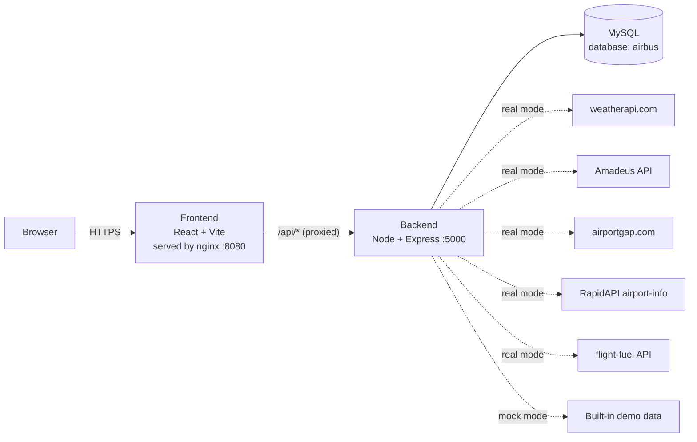

# Aerothon 6.0 — Flight Navigation

A flight navigation tool built for Aerothon 6.0. It checks the weather along a flight route to decide whether the route is safe to fly, and when it isn't, finds alternate airports and the shortest safe alternate route using Dijkstra's algorithm.

**Live demo:** https://flight-navigation-frontend.vercel.app/

- [System design](#system-design)
- [Project structure](#project-structure)
- [API reference](#api-reference)
- [Run locally (from source)](#run-locally-from-source)
- [Run with Docker](#run-with-docker)
- [Deploy to OpenShift](#deploy-to-openshift)
- [Publishing images (CI/CD)](#publishing-images-cicd)

---

## System design



### Components

| Component | Tech | Role |
|---|---|---|
| **Frontend** | React 18, Vite, Tailwind, react-bootstrap, Leaflet maps, Chart.js/Recharts | UI for picking an aircraft and route, showing weather along the route, and searching alternate routes. In containers it's served by nginx, which also proxies `/api/*` to the backend so the browser only talks to one origin. |
| **Backend** | Node.js, Express (`flight-navigation-backend/server.js`) | REST API. Calls the external weather/airport/fuel APIs, evaluates weather limits, builds the route graph and runs Dijkstra, and stores results in MySQL. |
| **Database** | MySQL 8 (`deployDB.sql`) | Tables `aircraft_data`, `airports`, `destinationairport`, `fuel`, `nearestairport`, `weather`; seeded with aircraft health data. |

### Main flows

**1. Check a route (`/` page)**
1. User picks an aircraft (`GET /api/aircraft`) and origin/destination IATA codes.
2. Frontend gets the distance (`POST /api/airport-distance`) and the known routes (`GET /api/getRoute`), which list the intermediate cities each leg passes over.
3. For each city on the route, it fetches current weather (`POST /api/getlocation`) — the backend stores each reading in the `weather` table.
4. Each reading is checked against flying limits (visibility ≥ 1 km, wind ≤ 20 km/h); the route is safe only if every city passes.

**2. Find an alternate route (`/altroute` page)**
1. Frontend calls `POST /api/airport-graphs` with source and destination.
2. Backend finds airports within 280 km of the destination, builds a graph whose edges are only the legs with acceptable weather (plus great-circle distances from the source), and runs **Dijkstra** to get the shortest safe path.
3. Frontend shows the path, airport details (`GET /api/airport-info`) and fuel estimates (`GET /api/flight-fuel`).

### Mock mode

With `MOCK_EXTERNAL_APIS=true` (the default in Docker and OpenShift), every external API call is answered from built-in demo data in `flight-navigation-backend/mocks/`, so no API keys are needed. The demo data covers South Indian airports only — use codes like **BLR, MAA, IXE, COK, HYD, CJB, GOI, TRV**.

---

## Project structure

```
Aerothon-6.0/
├── flight-navigation-backend/     Express API (entry point: server.js, demo data in mocks/)
│   └── Dockerfile
├── flight-navigation-frontend/    React app (pages in src/pages, UI in src/components)
│   ├── nginx/                     nginx config used by the container image
│   └── Dockerfile
├── database/                      MySQL image: loads deployDB.sql on first start
├── deployDB.sql                   MySQL schema + seed data
├── helm/aerothon/                 Helm chart for OpenShift / Kubernetes
├── docker-compose.yml             Runs all three containers locally
└── .github/workflows/publish.yml  Builds and publishes images + chart to GHCR
```

---

## API reference

Base path: `/api`. Requests and responses are JSON. Locally the backend runs at `http://localhost:5000`; in containers, call it through the frontend (`http://<frontend>/api/...`).

| Method | Endpoint | Input | Description |
|---|---|---|---|
| GET | `/api/config` | — | `{ mockMode }` — whether mock mode is on. Also used as the health check. |
| GET | `/api/check-db-connection` | — | Checks the database connection. |
| GET | `/api/aircraft` | — | Aircraft list with engine health, hydraulics, avionics and alerts (from `aircraft_data`). |
| GET | `/api/getRoute` | — | Known routes and the intermediate cities each one passes over. |
| POST | `/api/airport-distance` | `{ from, to }` (IATA codes) | Distance and coordinates for two airports (airportgap). |
| POST | `/api/getlocation` | `{ location }` (city name) | Current weather for a city; also saved to the `weather` table. |
| POST | `/api/getFlyStatus` | `["City1", "City2", ...]` | `true` if the weather in every listed city is within flying limits. |
| POST | `/api/airport-graphs` | `{ sourceIataCode, destinationIataCode }` | Shortest safe alternate route: `{ path: [...], distance }`. `404` with `reason: "no_safe_route"` if every route has bad weather. |
| POST | `/api/get-nearest-airport` | `{ latitude, longitude, radius, destinationIataCode }` | Nearest airports to a point and the shortest path among them. |
| GET | `/api/airport-info` | `?iata=BLR` | Airport details (RapidAPI airport-info). |
| GET | `/api/flight-fuel` | `?aircraft=&distance=&gcd=` | Fuel burn and CO₂ estimate for a flight. |
| POST | `/api/insertAirport` | airport-distance response | Saves the origin airport to `airports`. |
| POST | `/api/insertDestinationAirport` | airport-distance response | Saves the destination airport to `destinationairport`. |
| POST | `/api/near` | `{ nearestAirport: { nearestAirportName, nearestCity, nearestIataCode } }` | Saves a nearest-airport result to `nearestairport`. |
| POST | `/api/insertFlightFuel` | flight-fuel response | Saves a fuel estimate to `fuel`. |

Example:

```
curl -X POST http://localhost:5000/api/airport-graphs \
  -H "Content-Type: application/json" \
  -d '{"sourceIataCode":"BLR","destinationIataCode":"MAA"}'
```

---

## Run locally (from source)

**Prerequisites:** Node.js 20+, MySQL 8.

1. **Database** — create a database named `airbus` and load the schema and seed data:
   ```
   mysql -u root -p -e "CREATE DATABASE airbus"
   mysql -u root -p airbus < deployDB.sql
   ```
   The backend's `mysql` driver needs the MySQL user to use `mysql_native_password` authentication (MySQL 8's default `caching_sha2_password` fails with "Client does not support authentication protocol").

2. **Backend**
   ```
   cd flight-navigation-backend
   cp .env.example .env      # then set DB_PASSWORD; keep MOCK_EXTERNAL_APIS=true for demo data
   npm install
   npm start                 # http://localhost:5000
   ```

3. **Frontend**
   ```
   cd flight-navigation-frontend
   npm install
   npm run dev               # Vite dev server, calls the backend at http://localhost:5000
   ```
   Set `VITE_API_URL` to point the UI at a different backend.

---

## Run with Docker

Images are published to one GitHub Container Registry package, `ghcr.io/srivatsa-nayak/aerothon`, with one tag per component:

| Image | Contents |
|---|---|
| `ghcr.io/srivatsa-nayak/aerothon:frontend-latest` | Built React app on nginx (port 8080), proxies `/api/*` to `BACKEND_URL` |
| `ghcr.io/srivatsa-nayak/aerothon:backend-latest` | Express API (port 5000), configured via env vars |
| `ghcr.io/srivatsa-nayak/aerothon:db-latest` | MySQL 8 that loads `deployDB.sql` on first start |

There is no plain `latest` tag — always pull with the component tag.

### Option A — Published images

```
docker network create aerothon

docker run -d --name db --network aerothon -e MYSQL_USER=airbus -e MYSQL_PASSWORD=airbus -e MYSQL_DATABASE=airbus -v aerothon-db:/var/lib/mysql/data ghcr.io/srivatsa-nayak/aerothon:db-latest

docker run -d --name backend --network aerothon -e DB_HOST=db -e DB_USER=airbus -e DB_PASSWORD=airbus -e DB_NAME=airbus -e MOCK_EXTERNAL_APIS=true ghcr.io/srivatsa-nayak/aerothon:backend-latest

docker run -d --name frontend --network aerothon -p 8080:8080 -e BACKEND_URL=http://backend:5000 ghcr.io/srivatsa-nayak/aerothon:frontend-latest
```

Each `docker run` is a single command. Open http://localhost:8080 (change the first `8080` in `-p` if that port is taken).

- On first start the database takes about a minute to load the seed data; the backend reconnects on its own, so just refresh.
- Keep the container names `db` and `backend` — the other containers find them by name.
- Logs: `docker logs db` / `backend` / `frontend`.

Clean up:

```
docker rm -f frontend backend db
docker network rm aerothon
docker volume rm aerothon-db        # deletes the database data
```

### Option B — Docker Compose (from the repo)

```
docker compose pull           # get the published images (skip to build them from local code instead)
docker compose up             # add --build to rebuild from local code
docker compose down -v        # stop and delete everything
```

Open http://localhost:8080. To use another port: `FRONTEND_PORT=8088 docker compose up` (PowerShell: `$env:FRONTEND_PORT=8088; docker compose up`).

### Backend environment variables

| Variable | Default | Description |
|---|---|---|
| `PORT` | `5000` | Port the API listens on |
| `MOCK_EXTERNAL_APIS` | `false` (`true` in compose/Helm) | Use built-in demo data instead of external APIs |
| `DB_HOST` / `DB_PORT` | `localhost` / `3306` | MySQL address |
| `DB_USER` / `DB_PASSWORD` / `DB_NAME` | `root` / — / `airbus` | MySQL credentials and database |
| `WEATHER_API_KEY` | — | weatherapi.com key (real mode) |
| `AMADEUS_CLIENT_ID` / `AMADEUS_CLIENT_SECRET` | — | Amadeus credentials (real mode); or a static `AMADEUS_API_KEY` token |
| `RAPIDAPI_KEY` | — | RapidAPI airport-info key (real mode) |

The frontend image takes one variable, `BACKEND_URL` (default `http://backend:5000`).

---

## Deploy to OpenShift

The Helm chart in `helm/aerothon` deploys the three images, a MySQL volume, a Secret, and an HTTPS Route. It is published as `oci://ghcr.io/srivatsa-nayak/aerothon` and works on the free OpenShift Developer Sandbox.

**Prerequisites:** the `oc` CLI (OpenShift console → **?** → **Command line tools**) and `helm` 3.8+.

1. **Log in** — OpenShift console → your username → **Copy login command** → run the `oc login --token=... --server=...` line.

2. **Install**
   ```
   helm install aerothon oci://ghcr.io/srivatsa-nayak/aerothon
   oc get pods -w            # wait for db, backend and frontend to be Running 1/1
   ```

3. **Open the app**
   ```
   oc get route aerothon -o jsonpath='{.spec.host}'
   ```
   Browse to `https://<that host>`.

**Configuration** — all options are in [`helm/aerothon/values.yaml`](helm/aerothon/values.yaml). Override with `--set` or `-f my-values.yaml`:

| Value | Default | Description |
|---|---|---|
| `image.repository` | `ghcr.io/srivatsa-nayak/aerothon` | Image package |
| `image.tag` | `latest` | Build to run; e.g. `sha-1a2b3c4` pins a specific commit |
| `backend.mockExternalApis` | `true` | Demo data instead of external APIs |
| `backend.apiKeys.*` | empty | API keys for real mode (stored in a Secret) |
| `database.password` | random | Generated on install and kept across upgrades |
| `database.persistence.size` | `1Gi` | MySQL volume size |
| `route.enabled` / `route.host` | `true` / auto | OpenShift Route and its hostname |
| `*.resources` | small | CPU/memory requests and limits (sized for the Developer Sandbox) |

**Common operations**

```
oc rollout restart deployment/aerothon-frontend deployment/aerothon-backend   # pick up new :latest images
helm upgrade aerothon oci://ghcr.io/srivatsa-nayak/aerothon --set ...          # change settings / new chart version
oc logs deployment/aerothon-backend                                            # backend logs
helm uninstall aerothon && oc delete pvc aerothon-db                           # remove everything, including data
```

To deploy from a local checkout instead of the published chart: `helm install aerothon ./helm/aerothon`.

---

## Publishing images (CI/CD)

`.github/workflows/publish.yml` runs on every push/merge to `master` and publishes to `ghcr.io/srivatsa-nayak/aerothon`:

- Images: `frontend-latest`, `backend-latest`, `db-latest`, plus `<component>-sha-<commit>` for each build
- Helm chart: tagged with `version` from `helm/aerothon/Chart.yaml` — bump it when you change the chart

To build an image locally:

```
docker build -t aerothon-frontend flight-navigation-frontend
docker build -t aerothon-backend flight-navigation-backend
docker build -t aerothon-db -f database/Dockerfile .       # run from the repo root
```
